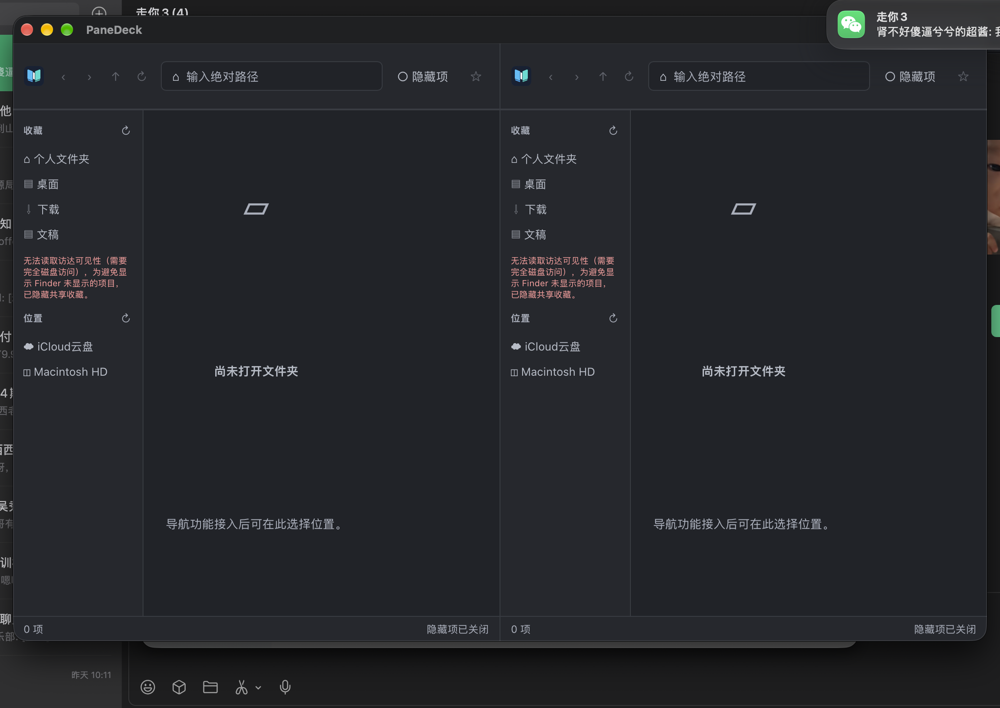

# v4 访达收藏只读探针（PD-320）

> 记录日期：2026-10-23 · 机器：macOS 27.2 (26B118) / arm64
> 方案：[product-plan-v4.md](product-plan-v4.md) · 任务：[tasks-v4.md](tasks-v4.md) · 验收：[v4-acceptance.md](v4-acceptance.md)
> 原始数据：[finder-favorites-probe.json](artifacts/v4/finder-favorites-probe.json)

## 1. 探针方法

隔离探针只调用 CoreServices `LSSharedFileList` 读取用户收藏并解析 URL：

- `kLSSharedFileListFavoriteItems` + `LSSharedFileListCopySnapshot`。
- `LSSharedFileListItemCopyResolvedURL`，flags 为 `NoUserInteraction | DoNotMountVolumes`。
- 显示名优先 `LSSharedFileListItemCopyDisplayName`，为空时用 `CFURLCopyResourcePropertyForKey(kCFURLLocalizedNameKey)`，再退回路径末段。
- 只接纳解析成功且当前为目录的项；不解析私有 `.sfl*` 文件，不写 Finder，不挂载卷。

探针源：[finder_favorites_probe.rs](../crates/panedeck-platform/examples/finder_favorites_probe.rs)。

## 2. 关键兼容性结果

| 运行方式                    | 结果                                            |
| --------------------------- | ----------------------------------------------- |
| 未打包 CLI 进程             | `count = 0`，`failed = false`                   |
| ad-hoc 签名的 `.app` bundle | `count = 8`，`unresolved = 0`，`failed = false` |

- 8 项均为可解析目录：Applications、Desktop、Documents、自定义工作区、Downloads、Movies、Music、Pictures；顺序与系统列表一致。
- 首次探针中 7 个系统项 `LSSharedFileListItemCopyDisplayName` 为空，使用 `kCFURLLocalizedNameKey`/路径回退得到 Applications/Desktop/... 等可读名称；后续独立探针在中文环境返回“应用程序/桌面/文稿/下载/影片/音乐/图片”。显示名依赖进程本地化，路径与顺序不变；自定义工作区名称原样保留。
- 未出现 AirDrop、最近使用或标签等虚拟项；无失效书签样本。
- 未修改 Finder 收藏，未写入 `.sfl*`，未挂载任何卷。
- 显示名依赖进程本地化：独立探针在中文环境返回“应用程序/桌面/文稿/下载/影片/音乐/图片”，PaneDeck 原生窗口回退为英文路径名。路径与顺序不受影响；未强制写入或改写系统名称。
- 关键兼容性：`LSSharedFileList` 既要求 `.app` bundle，也要求经 LaunchServices 启动；直接执行 bundle 内二进制会返回空列表。正式启动方式与 Finder/Dock 双击一致。
- 原生 Tauri 窗口（release 二进制 + ad-hoc `.app`，经 `open` 启动、真实 HOME）在启用可见性过滤前曾显示 Applications、BN-workspace、Movies、Music、Pictures；Desktop/Documents/Downloads 与常用目录去重后归入默认收藏。该历史截图见 [native-window.png](artifacts/v4/native-window.png)，仅证明 LS 可读；过滤启用后的当前行为见下方警告截图。

## 3. 与 Finder 可见侧栏的差异

同一台机器的全屏 Finder 窗口显示“个人收藏”为 iCloud 云盘、xinz、Macintosh HD、隔空投送、网络、废纸篓；而 LS 列表返回 8 项：Applications、Desktop、Documents、BN-workspace、Downloads、Movies、Music、Pictures。可见侧栏与 LS 列表**未逐项一致**。

- `LSSharedFileListItemCopyProperty(kLSSharedFileListItemHidden)` 对 8 项均返回 null，不能据此判断可见性。
- `com.apple.sidebarlists` 域在本机不存在，无法用公开默认值重建可见侧栏。
- 只读解析 `FavoriteItems.sfl4`：8 项 `visibility` 全为 0；`FavoriteVolumes.sfl4` 有 21 项且混合 0/1，但 Finder 只显示其中少数。可见性字段单独不能解释 Finder 可见列表，且共享列表包含历史残留项。
- 可能原因：Finder 设置中未勾选的 Sidebar 项目仍保留在共享收藏列表中。

**最终范围（2026-10-23）**：用户选择不授予完全磁盘访问，接受“隐藏共享项 + 警告”。应用不显示 `FavoriteItems` 自定义收藏，保留标准位置/应用收藏；不把隐藏项当作可见项。只读 `sfl4` 解析仅保留为有权限时的可选实现，不作为本次验收依据。

## 4. 应用权限与降级（2026-10-23）

- 直接运行探针二进制（终端上下文）：可读取 `FavoriteItems.sfl4`，`visibility_available=true`；8 项 `visibility=0` 全部过滤，结果 0 项，与当前 Finder 可见收藏一致。
- ad-hoc `.app` 经 LaunchServices 启动：读取 `~/Library/Application Support/com.apple.sharedfilelist/...` 返回 `Operation not permitted`；`visibility_available=false`，为避免显示隐藏项，回退为**不显示共享收藏**（0 项），UI 显示“需要完全磁盘访问”警告。
- 要让 PaneDeck 展示 Finder 可见自定义项，必须让应用获得**完全磁盘访问**；该权限不适合普通分发。用户最终决定不授予，采用隐藏全部共享项的范围。
- 实现已加入只读 `sfl4` 可见性过滤与 `visibilityAvailable` 警告；未授权/被拒时不会伪造可见性，隐藏共享项并明确提示。
- 用户曾授权只读解析；2026-10-23 尝试添加 `~/Documents/PaneDeck-Favorite-Test` 后，LS 列表仍为 8 项、`FavoriteItems.sfl4` 修改时间仍为 15:57，未观测到该测试项。最终用户选择不授予完全磁盘访问，当前范围改为隐藏共享项，不再要求复测可见项。

该图显示：未授权时两个窗格均提示“需要完全磁盘访问”，共享收藏被隐藏（不再显示 Applications/BN-workspace/Movies/Music/Pictures）。

## 5. 实现边界

- macOS 适配层在 `panedeck-platform`，只读返回 `FinderFavorites`；应用层缓存、超时、单飞后通过 Tauri 命令暴露。
- 前端将访达收藏与应用 localStorage 收藏合并：访达名称/顺序优先；应用独有项追加；同一路径去重；同名不同路径保留。
- 访达项没有删除按钮；应用项仍可删除。找不到或失败时保留最后有效快照和应用收藏，显示局部提示。
- 当前开发用未打包二进制可能拿到空列表；这是 API 的进程形态限制，不伪造结果。正式 `.app` 才能读取。
- 诊断与操作日志不包含收藏路径；收藏只用于本地导航。

## 6. 未测与范围

- 只在 macOS 27.2 验证；macOS 14/15/16 未验证，不能宣称全版本兼容。
- 未取得应用获得完全磁盘访问后的原生窗口结果；需用户在系统设置授权后复测。
- 中文界面下的系统显示名、失效书签、TCC 拒绝、虚拟项和 Finder 运行中的实时变化未覆盖。
- 未从真实 Finder 侧栏截图逐项对照；探针名称与顺序有数据证据，但未取得截图。
- 未写系统收藏，未提供“导入访达收藏”的一次性写入功能。
